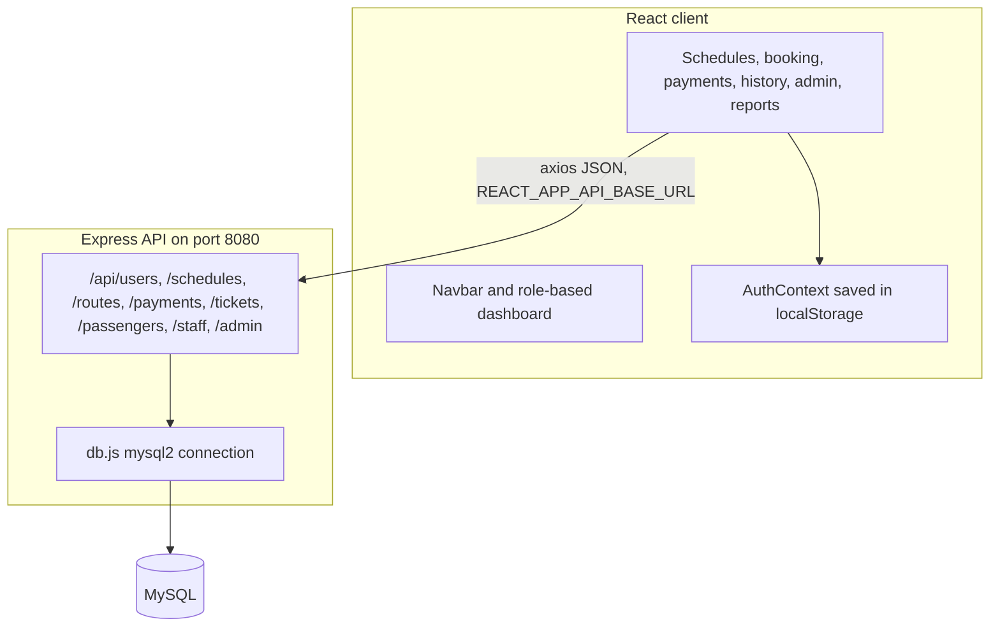
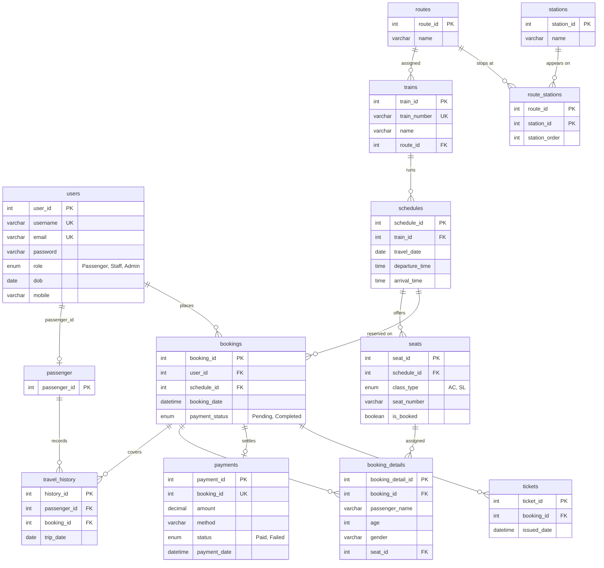

# Railway Management System

Full-stack railway operations app for schedules, seat inventory, bookings, tickets, and operational reports. A React client talks to an Express API, and the API reads and writes a normalized MySQL schema with parameterized SQL.

Sydney Ani led the UI work. The schema, queries, and role-specific screens are the parts of this repository aimed at data and software engineering review.

## Features

Accounts have one of three roles stored on `users.role`: `Passenger`, `Staff`, or `Admin`. The signed-in user is kept in `localStorage` under the key `user`. The login response omits the password column.

**Anyone**

- Register and sign in.
- Browse schedules and filter them by train name.
- Open a 404 page for unknown routes.

**Passenger and staff**

- Select one or more seats on a schedule. Booked seats are disabled.
- Check out from a payment screen. AC-style seat numbers are priced at ₹1500 and sleeper seats (numbers starting with `S`) at ₹800. Staff fares are stored at half of that amount. The seat picker shows a flat ₹1500 preview before the payment screen recalculates.
- The API writes one booking, one booking detail per seat, one payment, and one ticket. Card number, expiry, CVV, and name stay in the browser. The request sends `user_id`, `seat_ids`, `schedule_id`, `amount`, and `payment_method`.
- Review personal travel history, including fare, method, and payment date, and download that history as a PDF.

**Staff**

- Open Manage Rides and see booked passengers grouped by schedule.
- Remove a passenger from a seat. That action frees the seat and, when it was the last seat on the booking, deletes the booking detail, travel history, ticket, payment, and booking inside a transaction.

**Admin**

- Add, edit, and delete trains and schedules. A new schedule is created with 15 AC seats (`A1`–`A15`) and 15 sleeper seats (`S1`–`S15`).
- Add a route by name and attach trains to an existing route.
- Use the same passenger-removal view from the Admin Panel.
- Register additional users and choose Passenger, Staff, or Admin.
- Open three SQL reports: ticket sales and revenue, passenger gender mix, and seat occupancy. The sales and occupancy tables include a bar for occupancy. Demographics include a proportional bar per gender.

The public registration form submits `role = Passenger`. An admin who is already signed in can pick another role. The API stores whatever `role` value the request body sends.

## Architecture



`backend/server.js` mounts one router per area, logs each request, and returns JSON 404s for unknown API paths. Booking, payment, and passenger removal use `beginTransaction` so seat flags and booking rows commit or roll back together. Queries use `?` placeholders.

`scheduleRoutes.js` also exposes a second set of train, schedule, and route handlers under `/api/schedules/admin` and `/api/schedules/routes`. The React admin screens call `/api/admin` and `/api/routes`.

An earlier README linked `https://tech-solutions-production-e796.up.railway.app/`. A request to that host on 16 November 2026 returned Railway's fallback 404, so treat the URL as a historical deployment reference. CORS still allows that origin and `https://tech-solutions-production.up.railway.app`, plus `http://localhost:3000`. Extra origins can be added with `CORS_ORIGINS`.

## Database

The relational model lives in `backend/database.sql`. There is no ORM. `passenger` is a 1:1 extension of `users` (the passenger id is the user id). `route_stations` is the many-to-many between routes and stations and stores `station_order`. `payments.booking_id` is unique. `tickets.booking_id` is not unique, so the schema allows more than one ticket per booking. The app inserts one.



Seed data loads five Indian routes (Delhi–Mumbai, Chennai–Hyderabad, Bangalore–Kochi, Kolkata–Patna, Ahmedabad–Jaipur), seven stations, four trains, and ten schedules dated in April 2025. Only the first two routes have station stops. The schedule list returns those rows with no date filter. The first four schedules insert some sleeper seat numbers twice.

`backend/SQL-Queries` holds four validation queries: schedules for a route, upcoming departures for a named route, open seats for a train and date, and passenger count for a train. The history endpoints also run aggregate-style joins across bookings, seats, payments, and tickets. Age in profile lookups is `TIMESTAMPDIFF(YEAR, dob, CURDATE())`.

## Tech stack

| Layer | What the repo uses |
| --- | --- |
| Client | React 19, React Router 7, Axios, custom CSS. Create React App (`react-scripts` 5). |
| PDF | jsPDF, used by Travel History. |
| API | Node.js, Express 5, `cors`, `dotenv`. |
| Database | MySQL via `mysql2`. Schema and seed in `backend/database.sql`. |
| Auth | Username and password compared in SQL. No session store and no token. |

`bootstrap`, `uuid`, and `serve` are listed in `frontend/package.json` and are unused by the screens. `frontend/src/data/dummyDB.js` is empty.

## Setup

You need Node.js, npm, and a MySQL server. These steps were checked for command shape against this repo. They were not run against a live MySQL instance in the cleanup that added this README.

### 1. Create the database and load the schema

```bash
mysql -u root -p -e "CREATE DATABASE RailroadDB;"
mysql -u root -p RailroadDB < backend/database.sql
```

### 2. Configure the API

```bash
cp backend/.env.example backend/.env
```

Set `DB_HOST`, `DB_PORT`, `DB_USER`, `DB_PASSWORD`, and `DB_NAME` in `backend/.env`. If `DATABASE_URL` or `MYSQL_URL` is set, that URL is used instead of the `DB_*` variables. Percent-encode reserved characters in a URL password.

`backend/.env` is gitignored. Do not commit it.

The published history of this repository contained a live database password. Rotate that credential if the database still exists. Details are in the pull request that removed it. The password is not repeated here.

### 3. Start the API

```bash
cd backend
npm install
npm start
```

The process listens on `PORT` or **8080**. `GET /` returns `Backend API is running!`.

`npm run setup-db` runs `database.sql` through `db-setup.js` using the same environment variables. Prefer the `mysql` client in step 1 when you want to see SQL errors directly. Re-running the script against a database that already has these tables fails on `CREATE TABLE`.

### 4. Start the client

```bash
cp frontend/.env.example frontend/.env
cd frontend
npm install
npm start
```

`REACT_APP_API_BASE_URL` defaults to `http://localhost:8080` with no trailing slash. The dev server opens `http://localhost:3000`. The Create React App proxy is the same API origin, for any relative request.

### 5. Sign in and create an admin

Register from the home page. That account is a passenger.

The seed file does not insert users. To open the admin panel, insert one admin directly. Passwords are stored as plain text:

```sql
INSERT INTO users (first_name, last_name, username, email, password, gender, dob, mobile, role)
VALUES ('Ada', 'Admin', 'admin', 'admin@example.com', 'choose-a-password', 'Other', '1990-01-01', '5550001234', 'Admin');
```

Sign in as that user. From the dashboard, an admin can register staff and other admins.

## Project structure

```
.
├── LICENSE
├── README.md
├── backend
│   ├── .env.example
│   ├── database.sql          Schema and seed data
│   ├── db.js                 mysql2 connection
│   ├── db-setup.js           Applies database.sql
│   ├── server.js             Express app and CORS
│   ├── SQL-Queries           Ad hoc validation queries
│   └── routes
│       ├── userRoutes.js
│       ├── scheduleRoutes.js
│       ├── routes.js
│       ├── paymentRoutes.js
│       ├── ticketRoutes.js
│       ├── passengerRoutes.js
│       ├── staffRoutes.js
│       └── adminRoutes.js
└── frontend
    ├── .env.example
    ├── public
    └── src
        ├── App.js            Routes
        ├── context/AuthContext.js
        ├── pages              Home, NotFound
        └── components         Login, Register, Dashboard, BookTrain,
                               Payments, ViewSchedule, TravelHistory,
                               ManageRides, AdminPanel, Reports
```

## API

| Method | Path | What it writes or returns |
| --- | --- | --- |
| POST | `/api/users/register` | Inserts `users`. Passenger role also inserts `passenger`. |
| POST | `/api/users/login` | Returns the user row without `password`. |
| GET | `/api/users/booking/:booking_id` | Ticket, train, seat, and payment fields for a booking. |
| GET | `/api/schedules` | Schedules joined to train name, ordered by travel date. |
| GET | `/api/schedules/trains` | Every train. |
| GET | `/api/schedules/seats/:schedule_id` | Seat id, number, and booked flag. |
| POST | `/api/schedules/seats/book` | Books one seat and writes booking plus booking detail. |
| GET | `/api/routes` | Route id and name. |
| POST | `/api/routes` | Inserts a route name. |
| POST | `/api/payments/process` | Books the given seats, inserts a `Paid` payment, sets the booking to `Completed`. |
| POST | `/api/tickets/create` | Inserts a ticket for `booking_id`, or returns the existing one. |
| GET | `/api/tickets/:ticket_id` | Ticket detail joined to schedule, train, route, seat, and payment. |
| GET | `/api/tickets/booking/:booking_id` | Same shape, looked up by booking. |
| GET | `/api/tickets/user/:user_id` | That user's tickets, newest travel date first. |
| GET | `/api/passengers/:user_id` | Profile where `role` is Passenger. |
| GET | `/api/passengers/:user_id/history` | Booking history. Inserts missing `travel_history` rows. |
| POST | `/api/passengers/history` | Inserts a travel-history row. |
| GET | `/api/staff/rides-with-passengers` | Booked seats grouped by schedule. |
| GET | `/api/staff/passenger-details/:username` | Name, contact fields, and age. |
| GET | `/api/staff/:user_id/history` | That user's bookings. Adds a `passenger` row for staff if needed. |
| POST | `/api/admin/add-train` | Inserts a train on a route. |
| PUT | `/api/admin/edit-train/:train_id` | Updates train number, name, and route. |
| DELETE | `/api/admin/delete-train/:train_id` | Deletes the train, its schedules, and those seats. |
| POST | `/api/admin/add-schedule` | Inserts a schedule and 30 seats. |
| PUT | `/api/admin/edit-schedule/:schedule_id` | Updates train, date, and times. |
| DELETE | `/api/admin/delete-schedule/:schedule_id` | Deletes the schedule and its seats. |
| GET | `/api/admin/passenger-details/:username` | Same profile lookup as the staff route. |
| GET | `/api/admin/reports/sales` | Paid payments grouped by schedule: count and sum of amount. |
| GET | `/api/admin/reports/demographics` | `booking_details.gender` counts and share of all booking details. |
| GET | `/api/admin/reports/occupancy` | Booked seats, total seats, and occupancy rate per schedule. |
| DELETE | `/api/admin/remove-passenger/schedule/:schedule_id/seat/:seat_number` | Frees the seat and cleans up an empty booking. |

Role labels on these paths match how the UI calls them. Any caller who can reach a handler can run it.

## Scope and limits

- Passwords are stored and compared as plain text.
- Admin and staff screens hide themselves in React. The API will run the same handlers for any caller who can reach it.
- Checkout records a payment row with status `Paid`. Card fields remain in the browser.
- Travel History formats amounts as USD. The payment screen formats fares as rupees.
- `travel_history` inserts use `ON DUPLICATE KEY UPDATE`, and the table has no unique key on `(passenger_id, booking_id)`, so repeat visits can insert another history row.
- Deleting a train removes schedules and seats. Bookings that still reference those schedules remain.
- `frontend/src/App.test.js` renders the home page and looks for the railway management heading. That is the only automated test. `npm test` in `frontend` is the Create React App watcher. The API package has start and setup scripts only. Jest maps `react-router-dom` 7.5 to its CommonJS build because that release's `main` field points at a file the package does not ship.

## Roadmap

- Hash passwords and reject `role` on public registration unless the caller is an admin.
- Require a server-side role check on `/api/admin` and `/api/staff`.
- Add a unique key for `travel_history (passenger_id, booking_id)` so the history upsert matches the query.
- Search schedules by station using `route_stations.station_order`. The booking UI currently filters on train name.
- Move the April 2025 seed dates forward and stop inserting duplicate sleeper seat numbers on the early schedules.
- Send checkout to a payment provider. Keep storing only the method, amount, and status.
- Drop unused frontend dependencies and the empty `dummyDB.js` module, or start using them on purpose.

## Team

UI development lead: Sydney Ani.

Alessandra Alvarado-Escobar, Somil Doshi, Nupoor Vijay Kumbhar, Nikita Anil Yadav, Tamjida Nasreen Purba, Md Moshiur Rahman, Muhammad Saad Raja, Shreya Telavane, and Nicolas Osorio built the project with Sydney.

## License

[MIT](LICENSE). Copyright (c) 2025 Sydney Ani and contributors.
